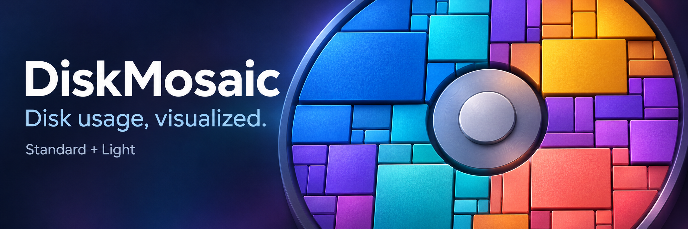
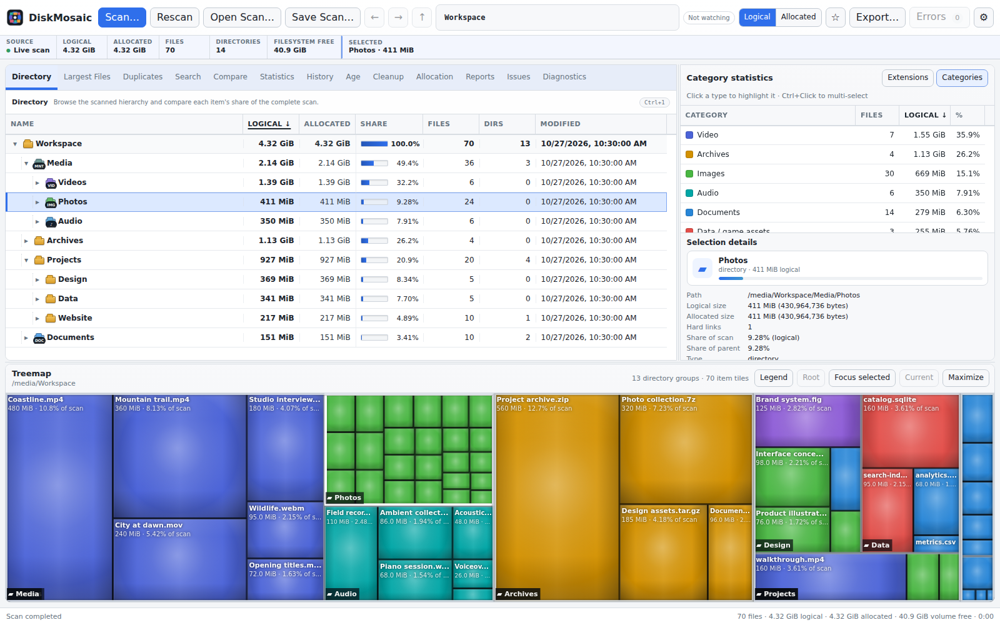
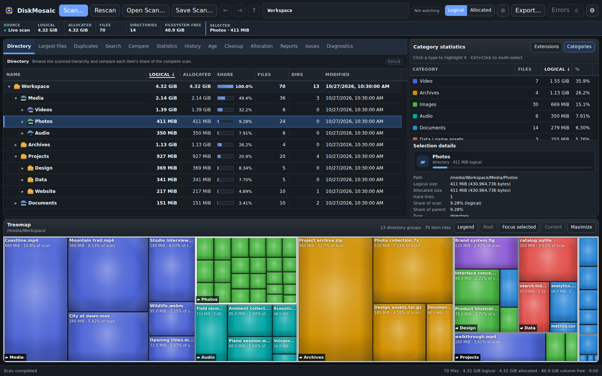
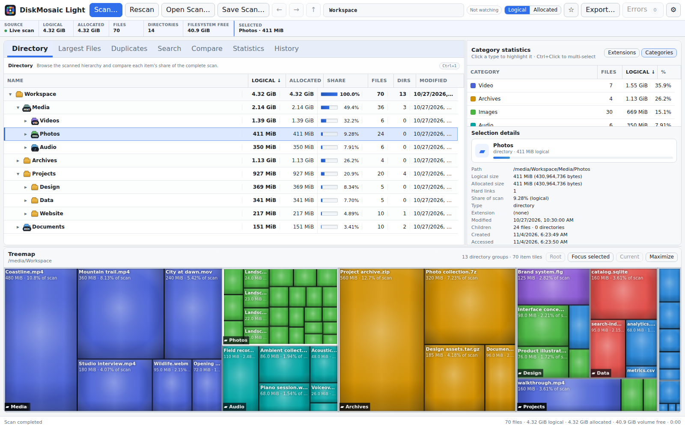
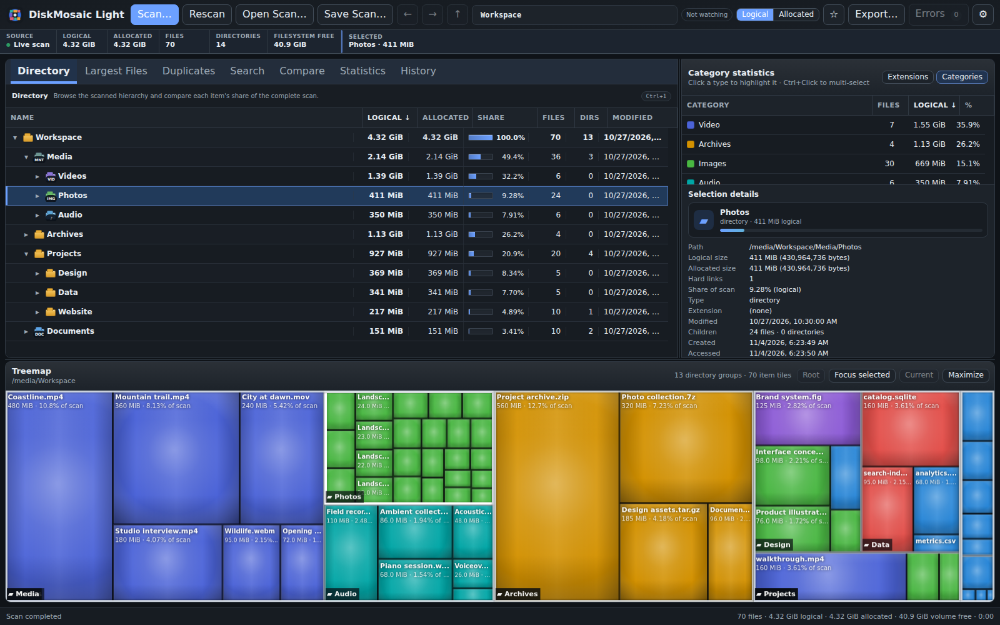

# DiskMosaic

**Explore disk usage, find duplicates, and understand how storage changes over time.** DiskMosaic is an offline disk-usage analyzer for Windows and Linux. A native Rust engine powers interactive treemaps, searchable file tables, exact duplicate verification, and local scan history in a sandboxed desktop interface.

[Download 1.0.1](https://github.com/Davoda1/Disk-Mosaic/releases/tag/v1.0.1) · [User guide](docs/USER-GUIDE.md) · [Build from source](docs/BUILDING.md) · [Security](SECURITY.md)

## Download

Version **1.0.1** is available in two editions. **DiskMosaic** provides the full analysis workspace; **DiskMosaic Light** offers a compact interface with the core scanning, treemap, duplicate, and history tools. Both editions work locally without accounts or telemetry.

| Platform or package | DiskMosaic | DiskMosaic Light |
| --- | --- | --- |
| Windows 10/11 · x64 | [Portable ZIP](https://github.com/Davoda1/Disk-Mosaic/releases/download/v1.0.1/DiskMosaic-1.0.1-Windows-x86_64.zip) | [Portable ZIP](https://github.com/Davoda1/Disk-Mosaic/releases/download/v1.0.1/DiskMosaic-Light-1.0.1-Windows-x86_64.zip) |
| Linux · amd64 | [Portable TAR.GZ](https://github.com/Davoda1/Disk-Mosaic/releases/download/v1.0.1/DiskMosaic-1.0.1-Linux-x86_64.tar.gz) | [Portable TAR.GZ](https://github.com/Davoda1/Disk-Mosaic/releases/download/v1.0.1/DiskMosaic-Light-1.0.1-Linux-x86_64.tar.gz) |
| Debian / Ubuntu · amd64 | [DEB package](https://github.com/Davoda1/Disk-Mosaic/releases/download/v1.0.1/DiskMosaic-1.0.1-Linux-x86_64.deb) | [DEB package](https://github.com/Davoda1/Disk-Mosaic/releases/download/v1.0.1/DiskMosaic-Light-1.0.1-Linux-x86_64.deb) |
| Standalone source | [Source TAR.XZ](https://github.com/Davoda1/Disk-Mosaic/releases/download/v1.0.1/DiskMosaic-1.0.1-Source.tar.xz) | [Source TAR.XZ](https://github.com/Davoda1/Disk-Mosaic/releases/download/v1.0.1/DiskMosaic-Light-1.0.1-Source.tar.xz) |

[Release notes](docs/RELEASE-1.0.1.md) · [SHA-256 checksums](https://github.com/Davoda1/Disk-Mosaic/releases/download/v1.0.1/SHA256SUM.txt) · [Repository source archives](source-archives/1.0.1)

Extract the complete portable archive before launching the application. Binary packages include the desktop runtime and Rust engine; Node.js and Rust are only needed for development. Linux builds require a graphical session and Chromium sandbox support. On systems that restrict unprivileged user namespaces, use the Debian package to install the sandbox helper with its required permissions.

The editions can be installed together and keep separate settings and history. **Light refers to the simpler interface.** Both editions include the same desktop-runtime family, so their download sizes are comparable.

## Screenshots

The screenshots show actual application views of a sample workspace. Both editions support light and dark appearance, including automatic selection from the operating system's theme.

### DiskMosaic

**Light theme**



**Dark theme**



### DiskMosaic Light

**Light theme**



**Dark theme**



## Compare editions

| Capability | DiskMosaic | DiskMosaic Light |
| --- | --- | --- |
| Workspace | Full analysis interface | Compact interface |
| Logical and allocated disk usage | Included | Included |
| Cushioned 2D and optional extruded 3D treemaps | Included | Included |
| Search, scan exclusions, and type/category colors | Included | Included |
| Exact duplicate verification and reviewed Trash actions | Included | Included |
| Saved scans, comparison, and local SQLite history | Included | Included |
| Incremental refresh and optional filesystem watching | Included | Included |
| History exploration | Timeline and indexed analyses | History list and comparison |
| Advanced faceted filters and Smart Collections | Included | — |
| Dedicated age, cleanup-candidate, and allocation analysis | Included | — |
| Report export | HTML, JSON, CSV, and Markdown summaries | JSON |

Both editions provide English, German, Hungarian, French, Italian, and Spanish interfaces.

## Get started

1. Select **Scan** and choose a folder or volume. Review any access errors when the scan finishes.
2. Select a table row or treemap tile to inspect it. Double-click a directory to explore it, then use breadcrumbs or navigation history to return.
3. Switch between **Logical** and **Allocated** size to compare file contents with the space reported as allocated by the filesystem.
4. Use **Search** to narrow the view by filename, path, extension, size, or modification time. Search and hidden-item visibility change the view; scan exclusions change what is recorded.
5. Save a `.dmscan` snapshot to revisit results or compare changes later.

Duplicate analysis checks equal-size candidates with BLAKE3 fingerprints and full hashes, then compares file bytes before marking them identical. Review each selection before moving files to Trash or the Recycle Bin. Single-item confirmation is enabled by default and can be changed in Settings; batch actions always require confirmation. Cleanup never runs automatically, and saved or historical scans are read-only views.

Local history belongs to the edition that created it. Use separate history databases because the editions have different internal schemas. Snapshots and exported reports can contain filenames and full paths; review them before sharing.

See the [user guide](docs/USER-GUIDE.md) for scanning options, duplicate analysis, history, reports, and troubleshooting.

## Privacy and design

Scanning and analysis run in a native Rust child process. The renderer receives bounded queries instead of complete filesystem models. The desktop interface uses context isolation, renderer sandboxing, and disabled Node integration. Runtime network requests and external navigation are blocked, and file actions pass paths through structured native APIs.

Settings, cached fingerprints, and optional history stay in the current user's application-data directory. Neither edition uploads scan data.

Filesystem permissions and metadata availability affect results. Sparse files, compression, allocation units, and hard links can make logical and allocated sizes differ. Disk capacity can also include metadata, reservations, inaccessible content, or snapshots outside the scanned model. Scanning an actively changing filesystem cannot produce a perfectly atomic view.

See the [security policy](SECURITY.md) for reporting and operating boundaries, and the [dependency review](docs/DEPENDENCY-REVIEW.md) for the dependency versions, audit scope, and update policy.

## Build from source

The release uses **Node.js 26.13.0 LTS** with **npm 11.20.0**, Rust with Cargo, and the platform's native build tools. Linux packaging also needs a C compiler, `dpkg-deb`, and `tar`; Windows packaging uses PowerShell 7. The [CI workflow](.github/workflows/build.yml) records the validated toolchain versions.

From the repository root, choose `editions/standard` or `editions/light`.

**Linux**

```bash
cd editions/standard
./scripts/build.sh
./scripts/package.sh
```

**Windows · PowerShell 7**

```powershell
Set-Location editions/standard
./scripts/build.ps1
./scripts/package.ps1
```

Build scripts validate the renderer, run the Node and Rust test suites, compile the engine, audit resolved Rust dependency licenses, and stage the application. Dependency resolution uses each edition's committed `engine/Cargo.lock` and `gui/package-lock.json`. Scripts do not install Rust or change global toolchain settings.

For source checks from the repository root:

```bash
node scripts/verify-source.mjs
npm --prefix editions/standard/gui test
npm --prefix editions/light/gui test
```

See [building, testing, and packaging](docs/BUILDING.md) for complete instructions and the distinction between source, renderer, and native platform checks.

## Repository layout

| Path | Contents |
| --- | --- |
| [editions/standard](editions/standard) | DiskMosaic application, native engine, tests, assets, and packaging scripts |
| [editions/light](editions/light) | DiskMosaic Light application, native engine, tests, assets, and packaging scripts |
| [docs](docs) | Shared user guide, build instructions, dependency review, and release notes |
| [docs/images](docs/images) | Repository banner and application screenshots |
| [scripts](scripts) | Repository validation, real-engine smoke checks, and source packaging |
| [source-archives/1.0.1](source-archives/1.0.1) | Standalone source packages and their checksum manifest |
| [.github](.github) | Windows/Linux CI, contribution templates, and issue templates |

The maintained branch is `master`. Changes to shared scanner or security behavior should be checked against both editions. See the [contribution guide](CONTRIBUTING.md).

## License

DiskMosaic application code and original project assets are licensed under **GNU Affero General Public License version 3 only (AGPL-3.0-only)**. Commercial use is permitted under the license's terms. Distribution and applicable modified network-service use carry source-code obligations. See the complete [license](LICENSE).

Third-party components retain their own licenses. The [Standard notices](editions/standard/THIRD_PARTY_NOTICES.md), [Light notices](editions/light/THIRD_PARTY_NOTICES.md), and edition-specific licensing audits describe the inventory and packaging checks. Binary packages retain Electron/Chromium notices and generated Rust dependency license texts.
